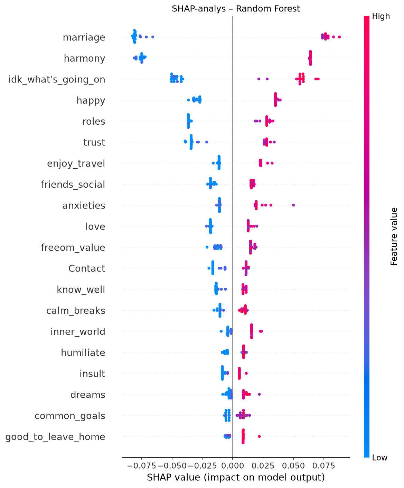
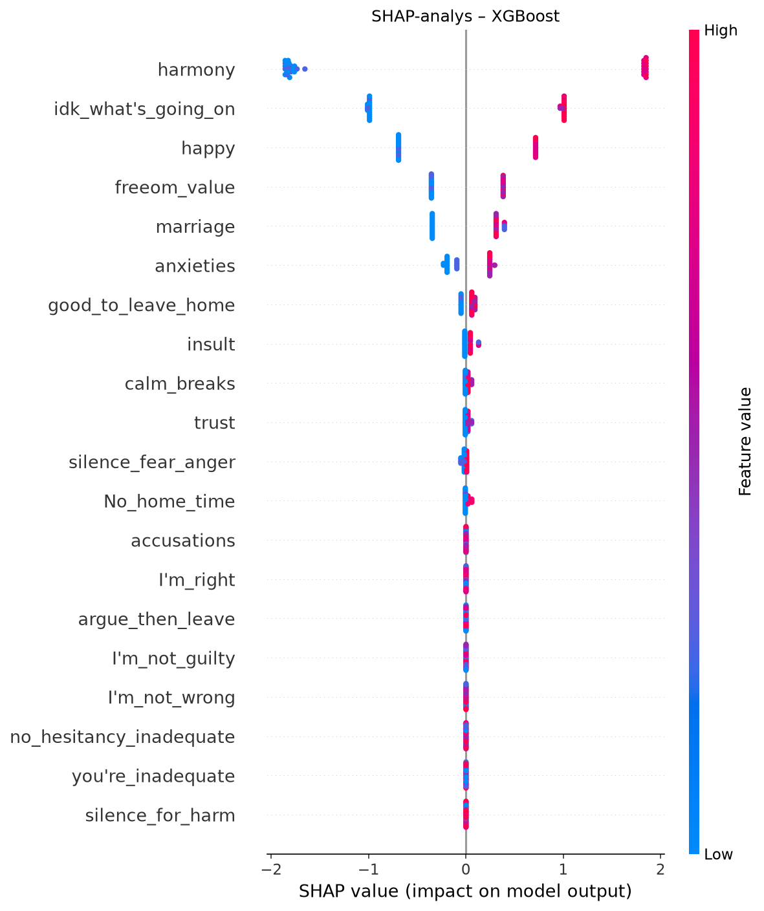

# Modellering och utvärdering – Random Forest och XGBoost

## 1. Syfte

Syftet med denna del av projektet är att utveckla och utvärdera två maskininlärningsmodeller, Random Forest och XGBoost, för att undersöka vilka faktorer som kan bidra till att förutsäga relationsstatus.

Modellerna används för binär klassificering med två klasser:

- Klass 0: Gift/stabil
- Klass 1: Skild

## 2. Metod

Datasetet innehåller 170 observationer. Data har delats upp i träningsdata (80 %) och testdata (20 %).

- Träningsdata: 136 observationer
- Testdata: 34 observationer
- Antal prediktorvariabler: 54

Två modeller har tränats och utvärderats:

**Random Forest:** En ensemblemodell som kombinerar flera beslutsträd för att förbättra prediktionerna.

**XGBoost:** En gradient boosting-modell där flera beslutsträd byggs stegvis för att förbättra modellens prediktionsförmåga.

Modellerna har utvärderats med accuracy, precision, recall, F1-score och ROC-AUC genom korsvalidering.

## 3. Resultat på testdata

| Utvärderingsmått | Random Forest | XGBoost |
|---|---|---|
| Accuracy | 0.941 | 0.941 |
| Precision (klass 1) | 1.000 | 1.000 |
| Recall (klass 1) | 0.882 | 0.882 |
| F1-score (klass 1) | 0.938 | 0.938 |

Båda modellerna uppnådde en träffsäkerhet på 94,1 % på testdata.

För klass 1 identifierade modellerna 15 av 17 observationer korrekt. Två observationer klassificerades felaktigt som klass 0.

Modellerna gav identiska resultat på testdata.

## 4. Korsvalidering

| Utvärderingsmått | Random Forest | XGBoost |
|---|---|---|
| Genomsnittlig accuracy | 0.985 | 0.982 |
| Genomsnittlig F1-score | 0.984 | 0.982 |
| Standardavvikelse F1 | 0.023 | 0.026 |
| Genomsnittlig ROC-AUC | 0.999 | 0.984 |

Random Forest uppnådde något högre genomsnittliga resultat än XGBoost vid korsvalideringen.

Skillnaderna är dock små och bör tolkas med försiktighet eftersom datasetet är begränsat.

## 5. SHAP-analys

SHAP (SHapley Additive exPlanations) har använts för att analysera hur olika variabler påverkar modellernas prediktioner.

SHAP-diagrammen visualiserar variablernas bidrag till prediktionerna och hjälper till att identifiera vilka faktorer som har störst betydelse i modellerna.

### Random Forest

### XGBoost

SHAP-värdena beskriver modellernas prediktioner och ska inte tolkas som bevis för orsakssamband.

## 6. Slutsats

Random Forest och XGBoost uppvisade identiska resultat på testdata med en accuracy på 94,1 %.

Random Forest presterade något bättre vid korsvalideringen, men skillnaderna mellan modellerna var relativt små.

Resultaten visar att båda modellerna kan identifiera mönster i datasetet. Samtidigt innebär det begränsade antalet observationer att resultaten bör tolkas försiktigt.

För en mer tillförlitlig bedömning behövs ytterligare validering med ett större och oberoende dataset.