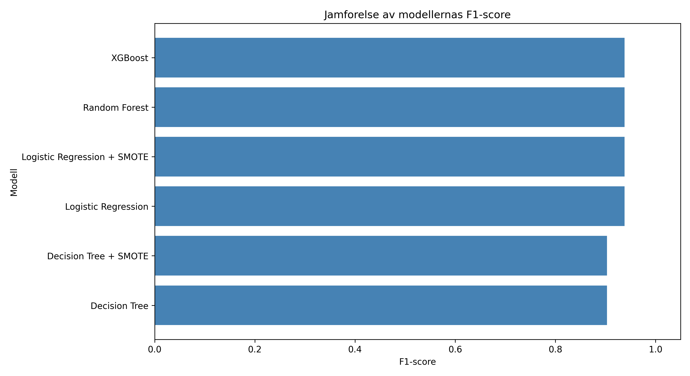
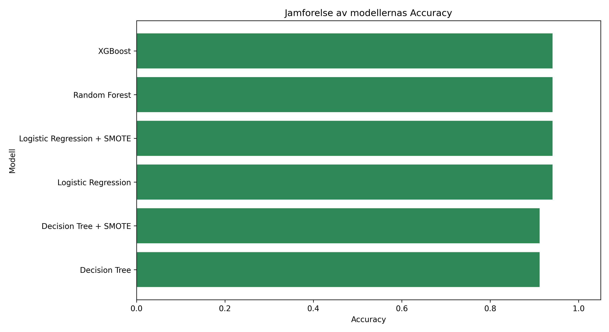

# Utvärdering av maskininlärningsmodeller

## 1. Syfte

Syftet med utvärderingen är att undersöka hur väl olika maskininlärningsmodeller kan förutsäga om en relation är stabil eller om den har slutat i skilsmässa, baserat på information från ett dataset med enkätfrågor.

I projektet jämförs fyra olika maskininlärningsmodeller:

- Logistic Regression
- Decision Tree
- Random Forest
- XGBoost

Logistic Regression och Decision Tree har även testats med SMOTE för att undersöka om balansering av träningsdata kan förbättra resultaten.

Målet är att jämföra modellernas prestationer, identifiera styrkor och svagheter samt rekommendera en lämplig modell.

## 2. Dataset och utvärderingsmetoder

Datasetet innehåller totalt 170 observationer, 54 förklarande variabler och en målvariabel som heter `Divorce_Y_N`.

Målvariabeln anger om observationen tillhör kategorin skilsmässa eller inte.

Datasetet delades upp enligt följande:

- Träningsdata: 136 observationer (80 %)
- Testdata: 34 observationer (20 %)

Modellernas resultat utvärderades med flera olika mått.

**Accuracy:** Andelen observationer som modellen klassificerar korrekt.

**Precision:** Hur stor andel av de observationer som modellen förutsäger som skilsmässor som faktiskt tillhör den kategorin.

**Recall:** Hur stor andel av de faktiska skilsmässorna som modellen lyckas identifiera.

**F1-score:** Ett mått som kombinerar precision och recall och visar balansen mellan dessa.

**ROC-AUC:** Ett mått på modellens förmåga att skilja mellan de två klasserna vid olika klassificeringströsklar.

Utöver dessa mått användes korsvalidering för att undersöka modellernas prestation på olika delar av träningsdatan.

Förväxlingsmatriser analyserades också för att undersöka vilka felklassificeringar modellerna gjorde.

## 3. Jämförelse av modellerna

Resultaten från testdatan visas i tabellen nedan.

| Modell | Accuracy | Precision | Recall | F1-score |
|---|---|---|---|---|
| Logistic Regression | 0.941 | 1.000 | 0.882 | 0.938 |
| Logistic Regression + SMOTE | 0.941 | 1.000 | 0.882 | 0.938 |
| Decision Tree | 0.912 | 1.000 | 0.824 | 0.903 |
| Decision Tree + SMOTE | 0.912 | 1.000 | 0.824 | 0.903 |
| Random Forest | 0.941 | 1.000 | 0.882 | 0.938 |
| XGBoost | 0.941 | 1.000 | 0.882 | 0.938 |

Resultaten visar att Logistic Regression, Random Forest och XGBoost uppnådde samma redovisade Accuracy och F1-score på testdatan.

Dessa modeller uppnådde 94,1 % Accuracy och 93,8 % F1-score.

Decision Tree hade något lägre resultat med 91,2 % Accuracy och 90,3 % F1-score.

Samtliga modeller fick Precision på 1,0. Det innebär att ingen av modellerna gjorde några falskt positiva förutsägelser för skilsmässoklassen i detta test.

Logistic Regression, Random Forest och XGBoost hade däremot högre Recall än Decision Tree. Det innebär att de lyckades identifiera en större andel av de faktiska skilsmässorna.

### Jämförelse av F1-score

Diagrammet visar att Logistic Regression, Random Forest och XGBoost presterade lika bra enligt F1-score, medan Decision Tree hade något lägre resultat.

### Jämförelse av Accuracy

Diagrammet visar samma mönster. Tre modelltyper uppnådde högst Accuracy, medan Decision Tree presterade något sämre.

## 4. Analys av förväxlingsmatriser

För att förstå modellernas klassificeringar analyserades även förväxlingsmatriser.

En förväxlingsmatris visar hur många observationer modellen har klassificerat korrekt respektive felaktigt.

### Logistic Regression

Logistic Regression klassificerade 32 av 34 testobservationer korrekt.

Resultatet visar att:

- 17 stabila relationer klassificerades korrekt.
- 15 skilsmässor klassificerades korrekt.
- 2 skilsmässor klassificerades felaktigt som stabila relationer.
- Inga stabila relationer klassificerades felaktigt som skilsmässor.

### Decision Tree

Decision Tree klassificerade 31 av 34 testobservationer korrekt.

Resultatet visar att:

- 17 stabila relationer klassificerades korrekt.
- 14 skilsmässor klassificerades korrekt.
- 3 skilsmässor klassificerades felaktigt som stabila relationer.
- Inga stabila relationer klassificerades felaktigt som skilsmässor.

Random Forest och XGBoost uppnådde samma redovisade Accuracy, Precision och Recall som Logistic Regression. Någon separat granskning av deras förväxlingsmatriser har däremot inte genomförts i denna utvärderingskod.

Resultaten visar att Logistic Regression gjorde färre felklassificeringar än Decision Tree.

Eftersom testdatasetet endast innehåller 34 observationer kan ett enskilt fel få relativt stor påverkan på resultaten.

## 5. Korsvalidering och överanpassning

Korsvalidering används för att undersöka hur stabila modellernas resultat är när olika delar av träningsdatan används för träning och validering.

I denna utvärdering jämfördes Accuracy från korsvalideringen med Accuracy från testdatan.

| Modell | CV Accuracy | Test Accuracy | Skillnad |
|---|---|---|---|
| Logistic Regression | 0.985 | 0.941 | 0.044 |
| Logistic Regression + SMOTE | 0.985 | 0.941 | 0.044 |
| Decision Tree | 0.975 | 0.912 | 0.063 |
| Decision Tree + SMOTE | 0.974 | 0.912 | 0.062 |
| Random Forest | 0.985 | 0.941 | 0.044 |
| XGBoost | 0.982 | 0.941 | 0.041 |

Samtliga modeller hade högre Accuracy vid korsvalideringen än på testdatan.

XGBoost hade den minsta skillnaden mellan korsvalidering och testresultat, med 4,1 procentenheter.

Decision Tree hade den största skillnaden, med 6,3 procentenheter.

En möjlig förklaring är att vissa modeller har anpassat sig för mycket till träningsdatan, vilket brukar kallas överanpassning eller *overfitting*.

Skillnaderna bevisar däremot inte att överanpassning har skett. Eftersom datasetet är litet kan variationer mellan träningsdata och testdata också påverka resultaten.

För att kunna bedöma modellernas generaliseringsförmåga säkrare behövs fler observationer och ytterligare tester.

## 6. Kontroll av dubbletter och dataläckage

En viktig del av utvärderingen var att undersöka om datasetet innehöll dubbletter som kunde påverka resultaten.

Kontrollen gav följande resultat:

- Totalt antal observationer: 170
- Antal dubblettrader: 20
- Antal träningsobservationer: 136
- Antal testobservationer: 34
- Testobservationer med identiska variabelvärden i träningsdata: 5

Det innebär att 5 av de 34 testobservationerna hade samma förklarande variabelvärden som minst en observation i träningsdatan.

Detta innebär en risk för missvisande utvärderingsresultat eftersom modellerna kan ha sett identiska variabelkombinationer under träningen.

Identiska enkätsvar behöver dock inte betyda att observationerna kommer från samma personer.

### Resultat utan identiska träningsrader

Gruppens modellering innehöll även en kontroll där Accuracy beräknades på de 29 testobservationer som inte hade identiska variabelrader i träningsdatan.

Resultatet blev:

| Modell | Accuracy på 29 testobservationer |
|---|---|
| Logistic Regression | 93,1 % |
| Decision Tree | 89,7 % |

Resultaten visar att Logistic Regression fortfarande presterade bättre än Decision Tree i denna kontroll.

Motsvarande kontroll har inte genomförts för Random Forest och XGBoost.

Det är också viktigt att förtydliga att denna kontroll inte innebär att modellerna tränades om på ett dubblettfritt dataset.

För en mer tillförlitlig utvärdering rekommenderas att dubbletter hanteras innan träningsdata och testdata delas upp, följt av ny träning och utvärdering av samtliga modeller.

## 7. Utvärdering av SMOTE

SMOTE är en metod som används för att skapa syntetiska observationer av en underrepresenterad klass i träningsdata.

I projektet testades SMOTE tillsammans med Logistic Regression och Decision Tree.

Resultaten visar att SMOTE inte förbättrade Accuracy, Recall eller F1-score för någon av dessa modeller.

Logistic Regression fick samma testresultat med och utan SMOTE.

Samma sak gällde Decision Tree.

En möjlig förklaring är att datasetet redan har en relativt jämn klassfördelning med 86 observationer i den ena klassen och 84 i den andra.

Utifrån de aktuella resultaten finns det därför ingen tydlig anledning att välja versionerna med SMOTE.

## 8. Modellernas styrkor och begränsningar

### Logistic Regression

Logistic Regression uppnådde ett av de bästa resultaten i utvärderingen.

Modellen är relativt enkel att använda och tolka. Dess koefficienter kan användas för att undersöka hur olika variabler påverkar modellens beräknade sannolikheter.

En begränsning är att modellen bygger på ett linjärt samband mellan variablerna och log-oddset för målvariabeln.

### Decision Tree

Decision Tree är en modell som är lätt att visualisera och förstå.

Den kan skapa regler som visar hur olika variabler används för att klassificera observationer.

I detta projekt uppnådde modellen något sämre resultat än de övriga modelltyperna.

### Random Forest

Random Forest kombinerar flera beslutsträd för att skapa mer robusta förutsägelser.

Modellen uppnådde samma redovisade testresultat som Logistic Regression och XGBoost.

En nackdel är att modellen kan vara svårare att tolka än Logistic Regression.

### XGBoost

XGBoost bygger flera träd stegvis, där nya träd används för att förbättra modellens förutsägelser.

Även XGBoost uppnådde 94,1 % Accuracy och 93,8 % F1-score.

Modellen hade den minsta skillnaden mellan korsvalidering och testresultat, men skillnaden mot övriga modeller var liten.

En nackdel är att modellen kan vara mer komplex och kräva fler inställningar.

### Tolkning med SHAP

Gruppen har även använt SHAP för Random Forest och XGBoost.

SHAP används för att undersöka hur olika variabler bidrar till modellernas förutsägelser.

Det är viktigt att skilja mellan variabler som påverkar en modells förutsägelse och variabler som faktiskt orsakar ett visst resultat.

Modellernas förklaringar ska därför inte tolkas som bevis för vad som orsakar skilsmässa.

## 9. Begränsningar och förbättringsförslag

Projektet har flera begränsningar som är viktiga att ta hänsyn till.

Den första begränsningen är datasetets storlek. Med endast 170 observationer är det svårt att avgöra hur väl modellerna skulle fungera på ett större och mer varierat dataset.

Den andra begränsningen är förekomsten av dubbletter. Detta kan påverka både modellträning och utvärdering.

Den tredje begränsningen är att vissa resultat för Random Forest och XGBoost har hämtats från gruppens modellrapport och lagts in manuellt i utvärderingskoden.

Test-ROC-AUC saknas dessutom i den gemensamma sammanställningen för dessa två modeller.

För att utveckla projektet vidare rekommenderas följande:

1. Testa modellerna på ett större och mer varierat dataset.
2. Hantera dubbletter innan data delas upp.
3. Använd samma utvärderingsmetoder för samtliga modeller.
4. Beräkna ROC-AUC och förväxlingsmatriser för alla modeller.
5. Genomför ytterligare tester för att undersöka överanpassning och generaliseringsförmåga.

## 10. Slutsats

Utvärderingen visar att Logistic Regression, Random Forest och XGBoost uppnådde samma redovisade testresultat med 94,1 % Accuracy och 93,8 % F1-score.

Decision Tree presterade något sämre med 91,2 % Accuracy och 90,3 % F1-score.

SMOTE förbättrade inte testresultaten för Logistic Regression eller Decision Tree.

Utifrån dessa resultat går det inte att utse någon av de tre bästa modelltyperna till en tydlig vinnare när man endast tittar på Accuracy och F1-score.

Logistic Regression utan SMOTE rekommenderas som ett lämpligt slutligt modellval eftersom modellen uppnådde lika bra resultat som de mer avancerade modellerna, samtidigt som den är relativt enkel att tolka.

Resultaten behöver dock tolkas med försiktighet eftersom datasetet är litet och innehåller dubbletter.

Sammanfattningsvis visar projektet att maskininlärning kan användas för att identifiera mönster i datasetet, men ytterligare validering krävs innan resultaten kan anses tillförlitliga för nya observationer.

## 11. Kod och resultatfiler

Utvärderingen genomfördes i Python med hjälp av bland annat pandas, matplotlib och scikit-learn.

Följande filer ingår i utvärderingsdelen:

- `notebooks/03_utvardering.py` – Python-kod för utvärderingen.
- `reports/utvardering/modelljamforelse.csv` – jämförelse av modellresultat.
- `reports/utvardering/korsvalidering_jamforelse.csv` – jämförelse mellan korsvalidering och testresultat.
- `reports/utvardering/f1_jamforelse.png` – diagram över F1-score.
- `reports/utvardering/accuracy_jamforelse.png` – diagram över Accuracy.
- `reports/utvardering/utvardering.md` – denna rapport.

Modellresultaten bygger på gruppens befintliga modellering i `02_modellering.py` och `02_random_forest_xgboost.py` samt tillhörande rapporter.

För att köra utvärderingen används följande kommando från projektets huvudmapp:

`python notebooks/03_utvardering.py`

Resultatfilerna sparas automatiskt i mappen `reports/utvardering/`.